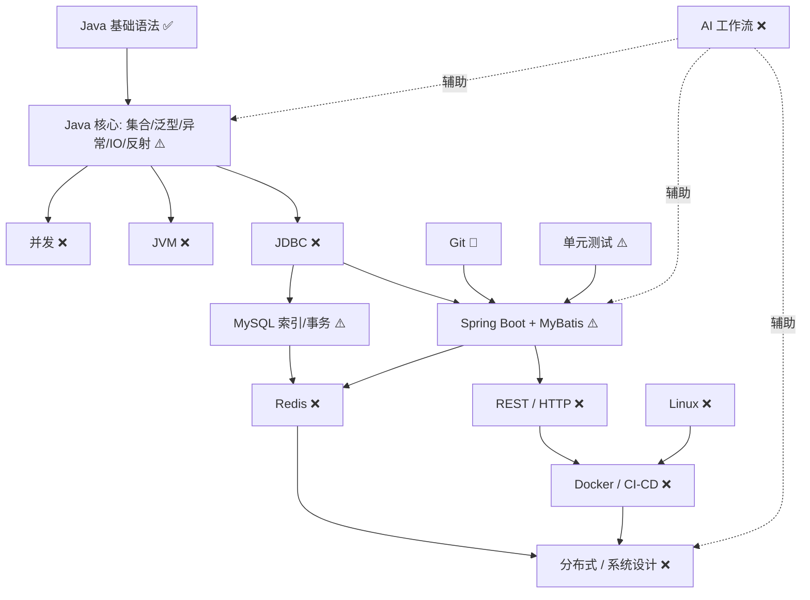

# KNOWLEDGE-GRAPH — 个人知识图谱

> **单一真相源**：能力状态只在本文件更新。每次阶段关门后同步一次，并追加修订记录。
> 基线版本：v1（2026-01，开工前自测）。
> 口径：✅ 已掌握 / ⚠️ 半掌握 / ❌ 空白 / 🔴 危险依赖。

## 状态表

| 模块 | 状态 | 风险 | 下一步 | 目标项目 |
|---|---|---|---|---|
| Java 基础语法 | ✅ | 不深 | 补集合、泛型、IO、反射 | P-A |
| 集合框架 | ⚠️ | 细节缺失 | 手写 ArrayList、HashMap 扩容 | P-A |
| HashMap | ⚠️ | 面试易挂 | 画底层结构，跑源码 | P-A |
| 异常 | ⚠️ | 体系不全 | 补 Error、业务异常设计 | P-A |
| 接口/抽象类 | ⚠️ | Java 8+ 没跟上 | 补 default/static/private | P-A |
| 单元测试 | ⚠️ | 无 Mock/集成测试 | 学 JUnit 5 + Mockito | P-A → P-B |
| Maven | ⚠️ | 生命周期不熟 | 学依赖冲突、多模块 | P-A |
| Git | 🔴 | 团队协作危险 | 手动解决冲突、rebase | P-A 起持续 |
| Spring Boot + MyBatis | ⚠️ | 底层被掩盖 | 往下挖 JDBC | P-B |
| JDBC | ❌ | **最大断层** | 纯 JDBC 写 DAO | **P-C** |
| MySQL | ⚠️ | 索引/事务不深 | 学 EXPLAIN、事务隔离 | **P-C** |
| 并发 | ❌ | 后端必备 | 线程池、锁、ConcurrentHashMap | 第一阶段后段 |
| JVM | ❌ | 调优/排错弱 | 内存模型、GC、类加载 | 第一阶段后段 |
| HTTP/网络 | ❌ | Web 基础不牢 | 抓包、理解完整链路 | P-B |
| Linux | ❌ | 部署排错难 | 常用命令、看日志、查进程 | P-B 部署期 |
| Docker | ❌ | 交付标配 | Dockerfile + Compose | 第三阶段 |
| Redis | ❌ | 缓存必备 | 穿透/击穿/雪崩 | 第三阶段 |
| AI 应用开发 | ❌ | 差异化缺失 | 大模型 API、RAG、Agent | 第三阶段 |

## 分层视图

- **表层能力**：Spring Boot CRUD、MyBatis 映射、Maven 建项目、基础语法。
- **真实掌握**：基础语法 + "会调框架 API"，其余多为"跟着 AI 走通"。
- **关键缺口**：JDBC、MySQL 索引与事务、并发、JVM、HTTP、Linux、Docker、Redis、测试体系。
- **危险依赖**：Git、调试、代码生成。
- **一年目标**：见 [`ROADMAP.md`](ROADMAP.md) 最终验收清单。

## 依赖图

## Top 10 补强清单（按优先级）

1. **JDBC**：纯 JDBC 写 DAO，完成 CRUD。→ P-C
2. **MySQL 索引与事务**：能解释 EXPLAIN，分析慢查询。→ P-C
3. **Git 手动操作**：手动解决冲突 + rebase。→ P-A 起
4. **JUnit + Mockito**：给 Service 层写带 Mock 的测试。→ P-B
5. **Java 并发基础**：解释线程池、锁、ConcurrentHashMap。→ 第一阶段后段
6. **HTTP 协议**：讲清请求到响应完整链路。→ P-B
7. **Linux 常用命令**：看日志、查进程、改权限。→ P-B 部署
8. **Redis 基础**：解释穿透/击穿/雪崩并写代码。→ 第三阶段
9. **Docker**：用 Dockerfile + Compose 部署项目。→ 第三阶段
10. **AI 工作流**：能写提示词，但不让 AI 代写核心。→ 全程

## 修订记录

| 版本 | 日期 | 变更 | 触发 |
|---|---|---|---|
| v1 | 2026-01 | 建立基线（18 节点自测状态） | 开工前诊断 |
